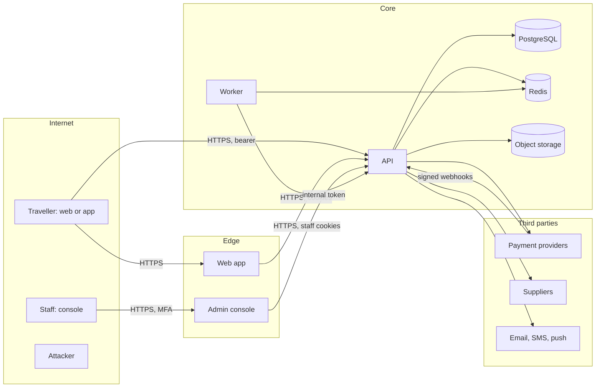

# Threat model

STRIDE analysis of the four areas where an attack costs money or exposes people: authentication,
payments, bookings and documents. Review it at the start of each phase and whenever a change
crosses a trust boundary below. Last reviewed: 2026-10-12 (phase 11).

## System and trust boundaries

| Boundary | Crossing                                     | Controls                                                                                      |
| -------- | -------------------------------------------- | --------------------------------------------------------------------------------------------- |
| B1       | Internet to the web, the console and the API | TLS, CSP, CORS and admin origin checks, authentication, rate limits, Turnstile or attestation |
| B2       | Payment providers to the webhook route       | Signature over the raw body, then verification with the provider                              |
| B3       | API to third parties                         | TLS, fixed hosts, no redirects, timeouts, adapters that map payloads                          |
| B4       | API and worker to data stores                | TLS in production, credentials per service, field encryption for restricted data              |
| B5       | Worker to the internal API                   | Bearer token, TLS, routes under `/v1/internal` only                                           |
| B6       | Staff to the admin API                       | Staff role, MFA session, IP allowlist, step-up for the riskiest actions, audit                |

**Actors:** anonymous visitors, guest bookers (with a booking token), signed-in travellers,
staff by role, payment providers, suppliers, the worker. **Attackers:** fraudsters with stolen
cards or accounts, scrapers, credential stuffers, curious travellers probing other bookings, a
malicious or compromised staff member, a compromised dependency.

**Assets:** customer money and the ledger, airline tickets and seats, personal and identity
data, staff privileges, pricing and margins, availability during peaks.

## Authentication and sessions

| STRIDE | Threat                                           | Mitigation                                                                                                                                           | Evidence                                                   |
| ------ | ------------------------------------------------ | ---------------------------------------------------------------------------------------------------------------------------------------------------- | ---------------------------------------------------------- |
| S      | Credential stuffing and password guessing        | Per-IP limits, per-identifier exponential lock, breached-password and context-word checks, argon2id, Turnstile on sign-up, MFA (mandatory for staff) | `login-throttle.service.ts`, `password-policy.ts`, ADR-007 |
| S      | Stolen refresh token replayed                    | Rotation on every use; reuse revokes the whole session and is audited                                                                                | `session.service.ts`, `auth.refresh_token.reused`          |
| S      | Account takeover through social sign-in          | Nonce bound to the request, verified issuer and audience, linking only to a verified email, no silent merge                                          | `social.service.ts`                                        |
| S      | Takeover through password reset or SMS codes     | Single-use hashed tokens with short lives, limits per email and phone, codes with attempt limits; reset revokes sessions                             | `auth.service.ts`, `otp.service.ts`                        |
| T      | Forged or altered access token                   | Ed25519 signatures, `kid`, fixed algorithm, 15-minute lifetime; revoked sessions are refused at once through a Redis denylist                        | `access-token.service.ts`                                  |
| T      | Cross-site request forgery with cookies          | `SameSite` cookies, a CSRF token bound to the session on unsafe methods, origin checks for admin calls                                               | `csrf.service.ts`, ADR-033                                 |
| R      | A user denies a sensitive change                 | Audit entries for sign-in, MFA, password, session and account changes, in the same transaction                                                       | `AuditAction`                                              |
| I      | Account enumeration                              | The same generic answer for a wrong password and an unknown account; registration and reset answer 202 either way and email the owner instead        | `auth.e2e-spec.ts`                                         |
| I      | Session tokens leak through logs or URLs         | HttpOnly `__Secure-` cookies, bearer tokens only in memory or Keychain, redaction, no tokens in URLs (guest tokens in fragments)                     | `logging-inventory.md`                                     |
| D      | Lockout used to block a real user                | Short exponential locks capped at 15 minutes; texted codes and social sign-in remain                                                                 | `login-throttle.service.ts`                                |
| E      | Staff privileges through a stolen staff password | MFA on every staff session, 30-minute idle and 12-hour absolute sessions, 3 devices, IP allowlist, step-up for role and refund approvals             | ADR-033, ADR-037                                           |
| E      | Privilege escalation through role changes        | Only `roles:manage` holders with step-up; nobody changes their own roles; the target is signed out everywhere; audited                               | `admin-users.service.ts`                                   |

## Payments and money

| STRIDE | Threat                                              | Mitigation                                                                                                                                 | Evidence                                       |
| ------ | --------------------------------------------------- | ------------------------------------------------------------------------------------------------------------------------------------------ | ---------------------------------------------- |
| S      | Forged webhook marks an unpaid booking as paid      | Signature over the raw body, then `verify()` against the provider API; only verified outcomes count                                        | ADR-016, `payment-events.service.ts`           |
| S      | Card testing and stolen cards                       | Hosted checkout with the provider's own fraud checks; payment start limits; risk scoring holds risky captures for finance before ticketing | ADR-040                                        |
| T      | Amount or currency tampered in the browser          | Amounts come only from the server's offer and ledger; the provider's verified amount must match, or the money is flagged for refund        | `payment.amount_mismatch`, ADR-016             |
| T      | Price changed between quote and payment             | Re-check before payment; a change needs the traveller's consent                                                                            | `booking.price_changed`, ADR-014               |
| T      | Ledger edited to hide a movement                    | Double entry with balance checks in the database; entries cannot be updated or deleted                                                     | ADR-017                                        |
| R      | Disputed refund approval                            | Maker-checker: the requester cannot approve; step-up; audit with both staff ids                                                            | ADR-019                                        |
| I      | Card data exposure                                  | Never received (SAQ-A). The card fingerprint for risk checks is an HMAC                                                                    | ADR-016                                        |
| D      | Provider outage blocks all payments                 | Routing by currency across providers; reconciliation catches up; alerts and runbook                                                        | `docs/runbooks/payment-provider-outage.md`     |
| E      | Refund larger than what was paid                    | Refunds capped at the source balance; idempotency keys; ambiguous calls go to review, never a blind retry                                  | `RefundsService`                               |
| E      | Duplicate charges or double fulfilment from retries | `Idempotency-Key` on every write that creates bookings, payments or refunds; webhook dedupe by event id                                    | `idempotency.interceptor.ts`, `webhook_events` |
| E      | Promo or referral abuse                             | Promo limits per IP and per user; referral rewards zero by default, a monthly cap, fraud signals send referrals to review                  | ADR-031, ADR-035                               |

## Bookings and inventory

| STRIDE | Threat                                                   | Mitigation                                                                                                                               | Evidence                            |
| ------ | -------------------------------------------------------- | ---------------------------------------------------------------------------------------------------------------------------------------- | ----------------------------------- |
| S      | Reading another person's booking by guessing references  | Owners by session; guests by a 256-bit token stored as an HMAC; everything else gets 404. Reference lookups are rate limited             | `BookingsService.load`, ADR-015     |
| T      | Status jumped (for example to CONFIRMED without payment) | Only `BookingTransitions.apply()` changes status, with state machine checks, an optimistic guard and history                             | ADR-014                             |
| T      | Oversold tours and packages                              | Conditional seat updates in the booking transaction                                                                                      | `reserveSeats`                      |
| R      | A traveller disputes a cancellation fee                  | Policy tiers stored with the product; cancellation audited with the tier applied; ledger entries                                         | ADR-028                             |
| I      | Passport and contact data exposed in responses           | Field encryption; responses show masked contact and the last three passport characters; staff reveal contact only with a reason, audited | ADR-015, `booking.contact_revealed` |
| I      | Markup and supplier cost leak                            | Prices only in responses; schema-filtered responses drop internal fields                                                                 | `contract.interceptor.ts`           |
| D      | Seat spinning through holds                              | Holds limited per IP and per account; supplier holds released on expiry                                                                  | ADR-018                             |
| D      | Scraping search to exhaust supplier quotas               | Per-IP and daily search quotas; cache-first results; circuit breakers                                                                    | `business-limits.md`                |
| E      | Paid booking ticketed despite a fraud hold               | Fulfilment checks for an open risk review; nothing fulfils around it                                                                     | ADR-040                             |

## Visa documents and generated files

| STRIDE | Threat                                             | Mitigation                                                                                                                       | Evidence                                   |
| ------ | -------------------------------------------------- | -------------------------------------------------------------------------------------------------------------------------------- | ------------------------------------------ |
| S      | Shared document link used by someone else          | Signed links valid for 5 minutes, bound to the document and the viewer type; access audited                                      | `visa-documents.service.ts`, ADR-026       |
| T      | Malicious upload (malware, polyglot files)         | Type checked by content, size limit, antivirus scan before anyone can open it, `Content-Disposition: attachment`, `nosniff`      | ADR-026                                    |
| T      | Stored file swapped in storage                     | AES-GCM per document with the key wrapped under a context bound to the document id; a failed tag is logged as an integrity error | `visa document failed its integrity check` |
| R      | Officer denies viewing a document                  | `visa.document_accessed` and `visa.document_link_issued` audit entries                                                           | `AuditAction`                              |
| I      | Documents kept too long or exposed through storage | Encrypted at rest with per-document keys; deleted 90 days after the application closes; private buckets only                     | ADR-026, ADR-039                           |
| I      | Ticket PDFs fetched by others                      | Same booking access rules as the booking; stored privately                                                                       | `booking-documents.service.ts`             |
| D      | Upload floods                                      | Per-IP upload limit, 60 files per application, 10 MB each, scanning in the worker                                                | `business-limits.md`                       |
| E      | Path traversal through file names                  | Storage keys are generated ids; original names are encrypted and only shown after sanitising                                     | `object-storage.ts`                        |

## Platform-wide threats

| Threat                                            | Mitigation                                                                                                                                                                                                                                                                                                                            |
| ------------------------------------------------- | ------------------------------------------------------------------------------------------------------------------------------------------------------------------------------------------------------------------------------------------------------------------------------------------------------------------------------------- |
| Cross-site scripting                              | React escaping, nonce-based CSP with `strict-dynamic`; `dangerouslySetInnerHTML` only for escaped JSON-LD and QR codes drawn locally                                                                                                                                                                                                  |
| Injection                                         | Prisma parameterised queries; Zod validation on every route; no shell or template evaluation of input                                                                                                                                                                                                                                 |
| Supply-chain compromise                           | Frozen lockfile, Dependabot, `pnpm audit`, Trivy, Semgrep and gitleaks with pinned, checksum-verified tools, a CycloneDX SBOM                                                                                                                                                                                                         |
| Compromised staff account                         | Least-privilege roles, MFA, step-up, audit, maker-checker for refunds, session revocation runbook                                                                                                                                                                                                                                     |
| Leaked keys                                       | Key rotation runbook, key ids for agility, no keys in the repository (scans on every push)                                                                                                                                                                                                                                            |
| Prompt injection through AI trip search (ADR-061) | The model has no tools and answers only a fixed JSON schema (structured output), validated again with Zod; places must resolve through our catalog, dates and travellers through the form's rules; the result only fills form fields the traveller sees before searching. A hostile text can at worst fill the form with wrong values |
| Cost abuse of the model provider                  | Off in production unless set; per-IP and per-user rate limits; each call reserves its worst case against daily spend caps per user or guest address and in total, settled to the billed tokens (`AiSearchBudget`)                                                                                                                     |
| Personal data typed into AI trip search           | `scrubQuery()` removes e-mail addresses, phone numbers and long digit runs before the call; the text is never stored or logged; the box tells travellers to leave personal details out                                                                                                                                                |
| Open redirect through partner links (ADR-070)     | Only AES-GCM tokens the API sealed open; the destination must be https on the programme's own hosts (or a tracked link on Travelpayouts' hosts); anything else answers 404                                                                                                                                                            |
| Forged or replayed conversion postbacks           | The network's secret compared in constant time; one row per network booking, states only move forward; strict parsing of ids, statuses and amounts; rate limits; commission is reported, never paid out by the platform                                                                                                               |
| Click inflation                                   | Rate limits on offers and redirects; clicks hold ids only and earn nothing on their own: networks pay for bookings                                                                                                                                                                                                                    |
| Mobile app tampering and fake clients             | Attestation on guest checkout and payments once verifiers are configured; no secrets in the bundle (scan)                                                                                                                                                                                                                             |

## Residual risks and accepted decisions

| Risk                                                                                                                                                         | Decision                                                                                                  |
| ------------------------------------------------------------------------------------------------------------------------------------------------------------ | --------------------------------------------------------------------------------------------------------- |
| Customer MFA is optional                                                                                                                                     | Accepted: travellers can enable it, staff must. Revisit with account takeover data (checklist V6.3.3)     |
| No certificate pinning in the app                                                                                                                            | Accepted: pinning risks outages on certificate rotation; TLS and attestation instead (MASVS-NETWORK-2)    |
| Device attestation runs with mock verifiers until the owner sets up App Attest and Play Integrity                                                            | Open owner action (ADR-023)                                                                               |
| AI trip search accuracy against the real model is unmeasured until the owner adds `LLM_API_KEY` and runs the eval; the model provider's data retention terms | Open owner action (ADR-061): one `ai-eval.yml` run (about a cent); choose standard or zero data retention |
| `style-src 'unsafe-inline'`                                                                                                                                  | Accepted: React style attributes; scripts stay strict (`zap-baseline.md`)                                 |
| Production infrastructure (WAF, network policies, backups, log shipping)                                                                                     | Phase 12                                                                                                  |
